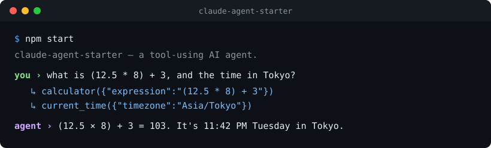

# claude-agent-starter

A minimal, well-documented **tool-using AI agent** in TypeScript, built directly on the
[Anthropic Claude API](https://docs.anthropic.com/en/api/messages). No agent framework —
just a clean, readable implementation of the **agentic loop** you can learn from and build on.

<p align="center"></p>

## What it demonstrates

- **The agent loop** — call the model → if it requests tools, run them → feed the results
  back → repeat until it answers. ~40 lines, no magic. ([`src/agent.ts`](src/agent.ts))
- **Clean tool design** — each tool pairs a JSON-schema *definition* the model sees with a
  local *executor*. Adding an ability is adding one object. ([`src/tools.ts`](src/tools.ts))
- **Correct context handling** — the full assistant turn (text, thinking and tool-use blocks)
  is preserved unchanged across turns, and all tool results go back in a single message.
- **Safe tool execution** — the calculator is a hand-written recursive-descent parser, not
  `eval`; tool errors are returned to the model as `is_error` results instead of crashing.

## The loop, in one picture

```
 user input
     │
     ▼
┌─────────────┐   stop_reason = "tool_use"   ┌──────────────────┐
│  Claude     │ ───────────────────────────▶ │  run the tools   │
│  /v1/messages│                             │  locally          │
│             │ ◀─────────────────────────── │  (tool_result[])  │
└─────────────┘        tool results          └──────────────────┘
     │
     │ stop_reason = "end_turn"
     ▼
 final answer
```

## Quick start

```bash
git clone https://github.com/Iniyarajan/claude-agent-starter
cd claude-agent-starter
npm install

cp .env.example .env          # then add your ANTHROPIC_API_KEY
npm start
```

Get an API key at [console.anthropic.com](https://console.anthropic.com/). The model defaults
to `claude-opus-5-5`; override it with `MODEL=claude-sonnet-5-5` in `.env`.

## Built-in tools

| Tool | What it does |
|------|--------------|
| `calculator` | Evaluates arithmetic with a safe recursive-descent parser (no `eval`). |
| `current_time` | Current date/time, optionally in any IANA timezone. |
| `search_knowledge_base` | Keyword search over a small in-memory knowledge base (a tiny RAG example). |

## Adding your own tool

Append one object to the `tools` array in [`src/tools.ts`](src/tools.ts):

```ts
const weather: Tool = {
  definition: {
    name: 'get_weather',
    description: 'Get the current weather for a city.',
    input_schema: {
      type: 'object',
      properties: { city: { type: 'string' } },
      required: ['city'],
    },
  },
  async execute(input) {
    const city = String(input.city);
    // ...call your weather API...
    return `It's 24°C and clear in ${city}.`;
  },
};
```

The agent picks it up automatically — no other changes needed.

## Project layout

```
src/
  tools.ts   — tool definitions + local executors
  agent.ts   — the agentic loop (Agent.send)
  index.ts   — a small interactive CLI
```

## License

MIT © Iniyarajan — [iniyarajan.dev](https://iniyarajan.dev)
